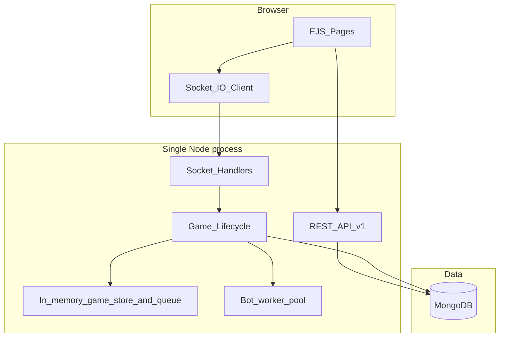

# Chess.com Clone

A real-time multiplayer chess platform: Elo matchmaking with time controls, a minimax bot that
runs in worker threads, server-authoritative games and clocks, MongoDB persistence, a REST API
with OpenAPI docs, Docker and CI.

## Features

- Real-time chess over Socket.IO; every move is validated on the server with chess.js
- Time controls with increment (1+0, 3+0, 3+2, 5+0, 10+0, 15+10) and an event-driven,
  millisecond-precision server clock
- Matchmaking per time control with a rating window that widens the longer you wait
- Rated games between registered players (Elo, K=40 for the first 30 games, then 20)
- Bot games (easy / medium / hard, three personalities) — **unrated**; search runs in a
  `worker_threads` pool with a time budget, so it never blocks other games
- Reconnect within a 30 s grace window; leaving for longer loses by abandonment
- Draw offers with real offer state, resignations, flag-fall (draw if the opponent cannot mate)
- JWT auth (registered + guest), change password (revokes all other sessions)
- Game records in MongoDB with PGN, clocks and rating changes
- Security: CSP, SameSite cookies + Origin-check CSRF defence, restricted Socket.IO origins,
  HTTP and per-socket-event rate limits, credential redaction in logs

## Tech Stack

| Layer    | Stack                                                  |
| -------- | ------------------------------------------------------ |
| Frontend | EJS, Vanilla JavaScript, CSS                           |
| Backend  | Node.js, Express, Socket.IO, worker_threads            |
| Data     | MongoDB (Mongoose); Redis optional (Socket.IO adapter) |
| Chess    | chess.js                                               |
| Ops      | Docker, GitHub Actions, Pino, Jest + socket.io-client  |

## Architecture



### Scaling model (read this before deploying)

Live games, clocks and the matchmaking queue live **in the memory of one Node process**, so the
app is designed to run as a **single instance**. That keeps moves fast and the code simple.

- On restart, live games are ended as `abandoned` (unrated) and players are notified; any record
  still `active` at boot is marked `abandoned`.
- `REDIS_URL` is optional and only plugs in the Socket.IO Redis adapter; it does **not** share
  game state between instances.
- The game store (`game/gameManager.js`) and queue (`game/matchmakingQueue.js`) are isolated
  behind small interfaces so they can later be moved to Redis (hashes per game, a sorted set
  per time control) with sticky sessions, if horizontal scaling is ever needed.

## Quick Start

### Prerequisites

- Node.js 20+
- MongoDB (Redis optional)

### Local development

```bash
cp .env.example .env
npm install
npm run dev
```

Open http://localhost:3000. Keep `NODE_ENV=development` locally: production mode requires
HTTPS cookies, `CLIENT_URL` and a 32+ character `JWT_SECRET`.

### Docker (one command)

```bash
docker compose up --build
```

## Scripts

| Script           | Description                                   |
| ---------------- | --------------------------------------------- |
| `npm start`      | Production server                             |
| `npm run dev`    | Backend with nodemon                          |
| `npm test`       | Jest: unit + socket integration (needs Mongo) |
| `npm run lint`   | ESLint                                        |
| `npm run format` | Prettier                                      |

## API

Base URL: `/api/v1`

| Endpoint                 | Description                                      |
| ------------------------ | ------------------------------------------------ |
| `POST /auth/register`    | Register (returns cookie + token)                |
| `POST /auth/login`       | Login                                            |
| `POST /auth/guest`       | Guest session                                    |
| `POST /auth/logout`      | Logout                                           |
| `GET /users/me`          | Current user                                     |
| `GET /users/:id`         | Public profile                                   |
| `POST /profile`          | Update display name / board colors               |
| `POST /profile/password` | Change password (revokes other sessions)         |
| `POST /profile/delete`   | Delete account                                   |
| `GET /games`             | Completed games (paginated)                      |
| `GET /games/:id`         | Game with PGN                                    |
| `GET /leaderboard`       | Top ratings                                      |
| `GET /stats`             | Platform stats                                   |
| `GET /health`, `/ready`  | Liveness / readiness (MongoDB), at the site root |

Interactive docs: **http://localhost:3000/api/v1/docs** (development only, or set
`ENABLE_API_DOCS=true`).

## Environment Variables

See [.env.example](.env.example).

| Variable          | Description                                                |
| ----------------- | ---------------------------------------------------------- |
| `MONGODB_URI`     | MongoDB connection string (required in production)         |
| `JWT_SECRET`      | JWT signing secret (required; 32+ chars in production)     |
| `CLIENT_URL`      | Public origin(s), comma-separated (required in production) |
| `REDIS_URL`       | Optional Socket.IO Redis adapter                           |
| `ENABLE_API_DOCS` | `true` to expose Swagger UI in production                  |
| `PORT`            | HTTP port (default 3000)                                   |
| `NODE_ENV`        | `development` locally, `production` when deployed          |

## Deployment

### Railway / Render / Fly.io

1. Set the environment variables above (run **one** instance)
2. Use managed MongoDB (Atlas)
3. The Dockerfile runs as a non-root user with a `/health` healthcheck

## Design Decisions

- **Server authority:** moves, clocks and results are decided on the server only.
- **One game lifecycle:** every ending (mate, resign, draw, flag, abandonment, shutdown) goes
  through `game/gameLifecycle.js#endGame`, which is idempotent — results can't be applied twice.
- **Atomic result writes:** ratings, counters and history are updated in a single pipeline
  `updateOne` per player, with both Elo changes computed from pre-game ratings.
- **Bots off the event loop:** iterative-deepening minimax in a worker pool with a deadline and a
  random-legal-move fallback.
- **userId-based reconnect:** socket IDs change on refresh; games are keyed by user ID, and only
  a player whose own side is disconnected can resume it.

## License

ISC
